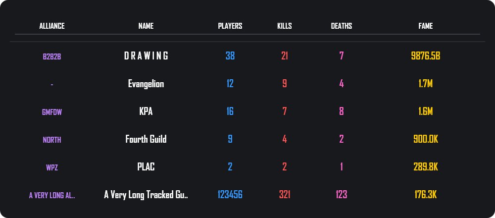
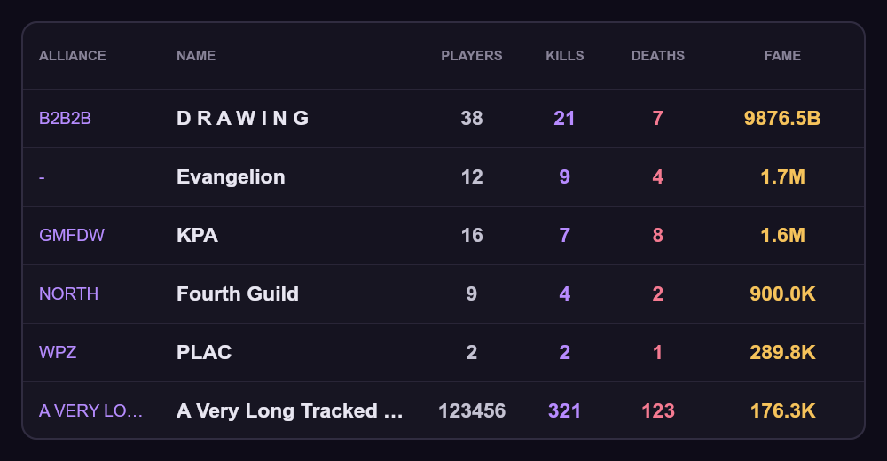

# Guild Summary Dark Theme V2 — review fixtures

Presentation-only change from Main `c8ac856373876d851af2e5ee91e3438dfb99a436`.
Every image below uses synthetic fixture data, not a Production report. Before
and after receive exactly the same selected Guild objects in the same order.

| Scenario | Rows | Before | After |
| --- | ---: | --- | --- |
| One Guild | 1 | [PNG](one-guild-before.png) | [PNG](one-guild-after.png) |
| Tracked Guild inside Top 4 | 4 | [PNG](four-guilds-tracked-top4-before.png) | [PNG](four-guilds-tracked-top4-after.png) |
| Tracked Guild outside Top 4 | 5 | [PNG](five-guilds-tracked-outside-before.png) | [PNG](five-guilds-tracked-outside-after.png) |
| Multiple tracked Guilds, long names, large numbers | 6 | [PNG](six-guilds-long-names-before.png) | [PNG](six-guilds-long-names-after.png) |

## Before



## After



The table is 1,000px wide, with 24px outer padding, 76px header and 66px per
selected row. The 952px table has an 8px inset on each side for the requested
936px column grid. The existing manual Top 4 default is retained; Auto-Battle
and merged BattleLink tables render every row selected by their existing callers.
`selectAutoBattleGuildSummaryRows()` and `battle-report-layout.js` are unchanged.

Fonts resolve once from installed Noto Sans, DejaVu Sans, Arial or Liberation
Sans, then generic sans-serif. There is no font download or new dependency.
These reviewed Windows previews use Arial; Linux/CoalByte will use the first
installed matching family. No Production font/render test has been run because
deployment is awaiting approval. See [fixture/font manifest](fixtures-and-font.json).

Auto-Battle content now contains the numeric Battle ID without a URL. The
existing validated Detail selector supplies the Link Button URL (AlbionZvZ
direct Detail or Official fallback). Only the first delivery part contains the
button, including the text-only fallback; `SuppressEmbeds` is an additional
guard. Weapon images and Guild Summary retain their original order. The
Battleboard delivery adapter forwards the same presentation payload without
changing routing, ACK, nonce, resume or persistence logic.

## Reproduce and verify

```sh
npm ci --ignore-scripts --no-audit --no-fund
node scripts/preview-guild-summary-v2.js
node --test test/*.test.js
```

The preview command requires the before commit to exist in the local Git
history. It loads only pure rendering functions, never the bot startup.

New tests render real PNGs and check dimensions/palette, measured truncation,
large Fame formatting, unchanged input values/order, tie breaks and tracked
deduplication. Discord.js serialization verifies Link Buttons and embed
suppression; isolated tests execute the real first/continuation send blocks and
the existing mocked integration delivery to check attachments, button placement,
nonces and continuation order. No network or Discord messages are used.

Local Windows validation: 67 focused tests pass. The full suite has two existing
wall-clock backup scheduler failures on this host. Both also fail when run from
unmodified Main in an isolated directory; no scheduler code or timing tests were
changed. Linux GitHub Actions is the full-suite gate.

No Merge, Deploy, Restart, Production environment change or database operation
is part of this draft. Review the PNGs before authorizing release.
